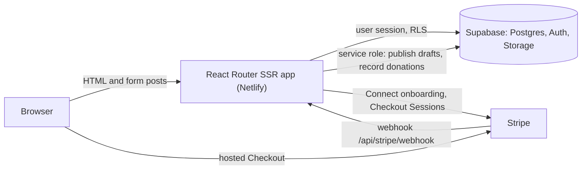

# CrowdUp

[](https://github.com/design-sparx/crowdup/actions/workflows/ci.yml)
[](LICENSE)

An open-source, self-hostable crowdfunding platform for personal projects, charities and NGOs. Organisers publish campaigns and receive donations straight into their own Stripe account; you run the platform on Supabase and Netlify.

**Live demo:** TODO(ticket 24): add the demo URL once the operator has deployed it (see [docs/demo.md](docs/demo.md)). There is no public demo yet.

<!-- PLACEHOLDER: screenshots and a demo GIF could not be produced in the repository tooling. A maintainer should add them under docs/images/ and link them here. -->
**Screenshots coming soon.** A demo GIF will be added here once a running instance exists.

## Features

What is built today (see [Known limitations](#known-limitations) for what is not):

- **Campaigns:** create, edit and publish campaigns with a rich-text story, cover image, goal, end date and category. Browse and filter on the public site. Owners can post plain-text updates and close campaigns.
- **Donations only:** no rewards, perks or equity. Donors can give as guests or signed in, anonymously if they wish. Signed-in donors get a donation history.
- **Stripe Connect (Standard), direct charges:** each organiser connects their own Stripe account and donations are charged on it. The platform never holds funds. An optional platform fee (`PLATFORM_FEE_PERCENT`, default 0) can be taken. See [docs/stripe.md](docs/stripe.md).
- **Auth:** email and password with password reset, optional Google sign-in, via Supabase Auth. Self-service signup is disabled by default — operators provision users (see [docs/self-hosting.md](docs/self-hosting.md#create-the-first-users)).
- **Admin area:** `/admin` for reports, campaign and user suspension (with reasons and an audit trail) and the approval queue. See [docs/moderation.md](docs/moderation.md) and [docs/reports.md](docs/reports.md).
- **Approval mode:** `PUBLISHING_MODE=approval` holds new campaigns for an administrator to approve or reject. The default `auto` publishes once the organiser has finished Stripe onboarding.
- **Abuse reporting:** anyone can report a live campaign, with rate limiting.
- **Legal templates:** Terms, Privacy and Security pages to adapt ([docs/operators-legal.md](docs/operators-legal.md)). Not legal advice.
- **Demo mode:** an optional banner, demo accounts and a guarded scheduled reset for a public demo ([docs/demo.md](docs/demo.md)).
- **Server-rendered**, with real 404 status and per-route meta tags.

## Tech stack

- [React Router 8](https://reactrouter.com/) framework mode (SSR), React 19, TypeScript 6, Vite 8
- [Tailwind CSS 4](https://tailwindcss.com/) with [shadcn/ui](https://ui.shadcn.com/) on [Base UI](https://base-ui.com/), Tiptap editor, Recharts
- [Supabase](https://supabase.com/): Postgres with row-level security, Auth, Storage
- [Stripe](https://stripe.com/) Connect
- Netlify (SSR via `@netlify/vite-plugin-react-router`)
- Vitest, Playwright, pgTAP; pnpm

## Architecture



Loaders and actions run on the server and read configuration from `process.env`; nothing is exposed to the browser. A map of the code is in [AGENTS.md](AGENTS.md).

## Quick start (local development)

Requirements: Node.js (current LTS), pnpm 9 (`corepack enable`), Docker and the [Supabase CLI](https://supabase.com/docs/guides/local-development) for the local database.

```sh
git clone https://github.com/design-sparx/crowdup.git
cd crowdup
pnpm install
supabase start        # local Postgres, Auth and Storage; applies migrations
supabase db reset     # re-applies migrations and loads supabase/seed.sql sample data
cp .env.example .env  # fill SUPABASE_ANON_KEY and SUPABASE_SERVICE_ROLE_KEY from `supabase status`
pnpm dev              # http://localhost:5173
```

The seed creates sample campaigns and users (`admin@`, `amara@`, `liam@`, `sam@`, `dana@` at `crowdup.example`), all with the local dev password **`crowdup-local-dev`** — sign in as `admin@crowdup.example` to start. (`admin@` is already an admin; set your own password after first login.) Self-service signup is off by default; to open registration set `AUTH_SIGNUP_ENABLED=true`, and to add users on a real instance see [docs/self-hosting.md](docs/self-hosting.md#create-the-first-users). Donations need Stripe test keys: see [docs/stripe.md](docs/stripe.md). Every environment variable is listed in [docs/self-hosting.md](docs/self-hosting.md#environment-variables).

## Scripts

| Script | What it does |
| --- | --- |
| `pnpm dev` | React Router dev server |
| `pnpm build` | typegen, `tsc`, production build |
| `pnpm lint` | ESLint, zero warnings allowed |
| `pnpm test` | Vitest unit tests |
| `pnpm test:db` | `supabase db reset` then pgTAP tests (needs local Supabase) |
| `pnpm test:e2e` | Playwright against the production build (build first; needs local Supabase) |
| `pnpm preview` | Serve `build/client` with Vite |

## Deploy and self-host

Follow [docs/self-hosting.md](docs/self-hosting.md): Supabase project, Stripe, Netlify and every environment variable.

[](https://app.netlify.com/start/deploy?repository=https://github.com/design-sparx/crowdup)

The button clones the repository into your Netlify account and, through the `[template.environment]` section of `netlify.toml`, prompts for the required variable names. **Deploying a fresh fork through this button has not been verified.** It does not create the Supabase project or the Stripe webhook; do those first as described in the guide.

## Documentation

See the [docs index](docs/README.md).

## Known limitations

- **Stripe Connect is not available in every country.** Organisers and the platform account must be in a [Stripe-supported country](https://stripe.com/global); Kenya is not a general Connect country at the time of writing. Check Stripe's current list before choosing this stack.
- **Nothing has been run against real services.** The database tests (`pnpm test:db`), the Playwright specs and the Stripe and Supabase flows were written without being executed against a database or Stripe; they first run when the CI workflows do. Treat your first deployment as a test.
- **No application emails in v1.** Only Supabase Auth emails (confirmation, password reset) are sent. There are no donation receipts or organiser notifications. Custom SMTP is only needed if you enable signup (`AUTH_SIGNUP_ENABLED`) or want self-service password resets ([guide](docs/self-hosting.md#1-supabase-project)).
- **One currency per campaign**, taken from the organiser's Stripe account when the campaign goes live and fixed afterwards. No multi-currency campaigns or conversion.
- **Report rate limit is in memory:** per server instance and reset on restart; on serverless it is a speed bump ([docs/reports.md](docs/reports.md)).
- **The database is not publishing-mode aware:** in `approval` mode, server code running with the service role could still publish a draft directly if app code were wrong ([docs/moderation.md](docs/moderation.md)).
- **Some UI is not wired to data:** the search drawer fields do nothing, and home-page testimonials and footer links come from static JSON in `src/data/`.
- **Legal pages are templates** and must be reviewed by a lawyer ([docs/operators-legal.md](docs/operators-legal.md)).

## Contributing

See [CONTRIBUTING.md](CONTRIBUTING.md), including [good first issue ideas](docs/good-first-issues.md). Report security issues privately as described in [SECURITY.md](SECURITY.md).

## License

MIT. See [LICENSE](LICENSE).
